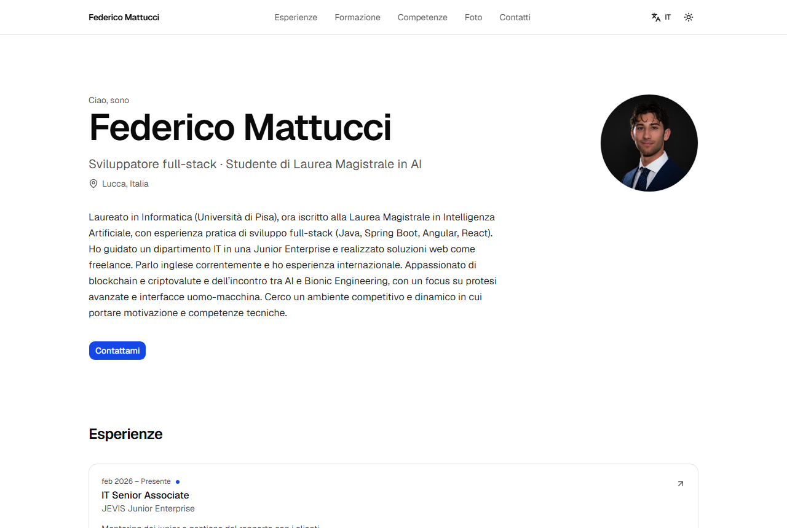
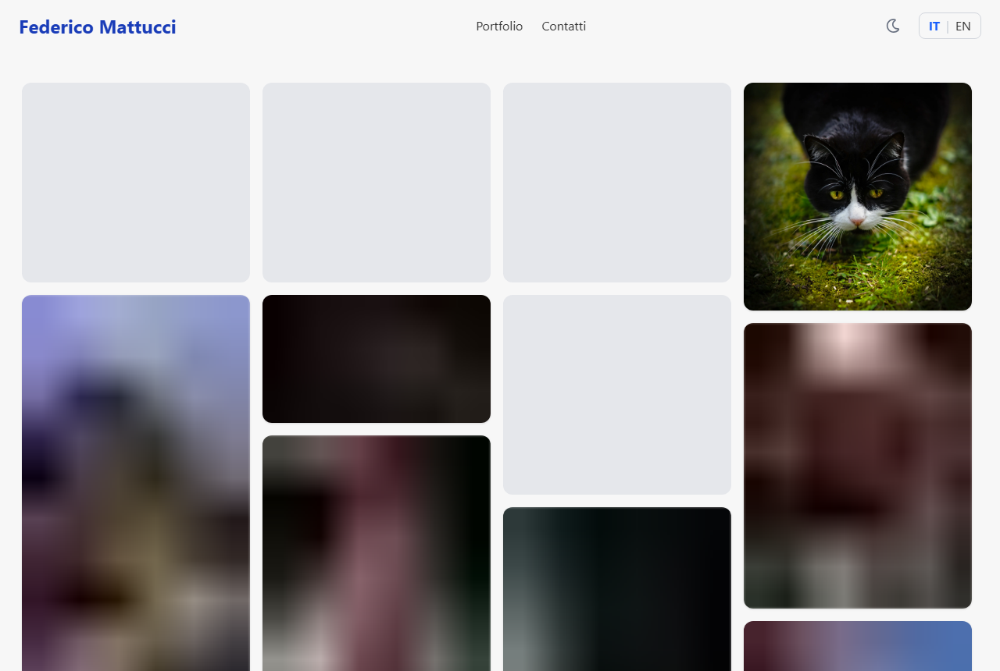
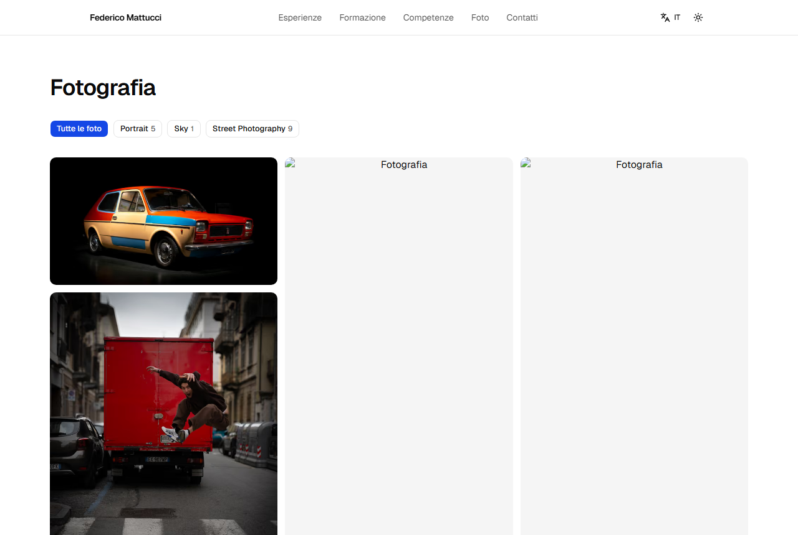

# Site redesign: database-backed, bilingual, with an in-site admin

`feat/site-redesign` -> `main`. **Do not merge until the checklist at the end is done**; I prepared this description
instead of opening the PR (the branch is pushed: open it from
https://github.com/FeMattu/FedericoMattucci/pull/new/feat/site-redesign).

## Summary

A complete rebuild of the site: minimal CV-style home with a top navigation bar, redone skills and projects, a rebuilt
photo portfolio, a contact form, Italian/English with an extensible architecture, light/dark theme, and an admin area to
edit everything (texts per language, all lists with drag-and-drop ordering, photo uploads, languages, messages).
Content is seeded from the updated CV. The old, unauthenticated image API is gone.

Details: [`CHANGELOG-REDESIGN.md`](CHANGELOG-REDESIGN.md). Choices where the brief was ambiguous:
[`DECISIONS.md`](DECISIONS.md). What was wrong before and what happened to it: [`issues-found.md`](issues-found.md).

## Before / after

| Before (`main`) | After |
| --------------- | ----- |
|  |  |
|  |  |
|  |  |

More: [dark theme](screenshots/after-home-en-dark.png) · [mobile menu](screenshots/after-mobile-menu.png) ·
[skills](screenshots/after-skills.png) · [experience detail](screenshots/after-experience-detail.png) ·
[lightbox](screenshots/after-photo-lightbox.png) · admin:
[dashboard](screenshots/after-admin-dashboard.png), [reorderable list](screenshots/after-admin-experience-list.png),
[edit form with translation tabs](screenshots/after-admin-edit-form.png), [photos](screenshots/after-admin-photos.png),
[languages](screenshots/after-admin-languages.png).

## What I verified

| Check                                                     | Result                                                          |
| --------------------------------------------------------- | --------------------------------------------------------------- |
| `npm run lint`, `npm run typecheck`                       | clean                                                           |
| Unit, component and integration tests                     | **312 passed** (33 files)                                       |
| Coverage on `src/lib` and `src/actions`                   | **97.1% lines**, 96.6% statements, 98.1% functions, 90.6% branches (threshold 80%) |
| Playwright (production build, isolated test database)     | **23 passed**, 1 skipped by design (mobile-only test on desktop) |
| `next build`                                              | green, 32 static pages                                          |
| Live access-control check (real DB sessions)              | admin: all admin pages 200; non-admin session: redirected; anonymous: redirected |
| Idempotent seed                                           | re-run changes nothing; a manual edit survives                  |
| Photo import                                              | 15 photos imported (11 with EXIF/size; 4 have no sidecar in S3) |

The E2E suite found two real bugs that unit tests could not (both fixed): a stale-cache race where two quick admin
saves left an old public page cached (the admin's "View site" link prefetched the page; see `DECISIONS.md` 16a), and a
test-environment lock issue with `.next` inside OneDrive (see `DEPLOY.md`).

## Not verified / known risks

- **Nothing was run on Vercel.** The preview needs a database and the environment variables in
  [`DEPLOY.md`](DEPLOY.md); without them the preview build fails (pages are generated from the database).
- **GitHub sign-in itself was not exercised** (it needs your OAuth app). Everything behind it was tested with real
  database sessions, and the allowlist and guards have unit, integration and E2E tests.
- **Photo optimizer timeouts.** The 6000 px originals can exceed Next's 7 s source-download budget on a slow link and
  show as blank boxes until a reload (reproduced locally on a cold cache). Likely fine on Vercel; if not, re-upload
  through the admin (downscales to 3200 px). See `DEPLOY.md` section 7.
- **S3 bucket CORS** must allow `PUT` from the site origin for browser uploads (`DEPLOY.md` section 4). Untested
  against the real bucket (uploads were tested with S3 mocked).
- **Resend e-mail** is untested against the real service (the code path is unit-tested with `fetch` mocked); messages
  are always stored in the database regardless.
- The admin UI is English only; in-place text editing became an "Edit this page" bar (`DECISIONS.md` 10).

## Manual steps after merging

1. Create the **GitHub OAuth app** (callback `https://<domain>/api/auth/callback/github`).
2. Create the **PostgreSQL database** and set the **Vercel environment variables**; set the build command to
   `npm run build:vercel`.
3. Run `npm run db:seed` and `npm run photos:import` once against the production database.
4. Add the **S3 CORS** rule.
5. In the admin: add the CV download link (*Site texts*), skill levels, and the details of the three draft projects.

## Test checklist (for the reviewer)

- [ ] `/it`, `/en`: top bar, anchors, language and theme switches; sheet menu at phone width
- [ ] Experience / education detail pages; `/it/does-not-exist` is a real 404
- [ ] `/it/photos`: filters; lightbox with arrow keys, `Esc`, swipe; details panel; hard-refresh once and check no blank photo
- [ ] Contact form: validation errors keep your text; a valid message appears in `/admin/messages`
- [ ] `/admin` signed out redirects to `/login`; sign in with GitHub as `ADMIN_EMAIL`; any other account is refused
- [ ] Edit a text in both languages, reorder a list with the mouse **and** the keyboard (Space, arrows, Space), hide an item
- [ ] Upload a photo; set its titles in both languages; feature it; check the home strip
- [ ] Languages page shows the untranslated counts
- [ ] Lighthouse on the home page (target 95+ on all four categories; not measured here)

## Rollback

Redeploy the previous Vercel deployment. Migrations are additive, so the old schema stays valid; restore the provider
snapshot if data needs to go back.
